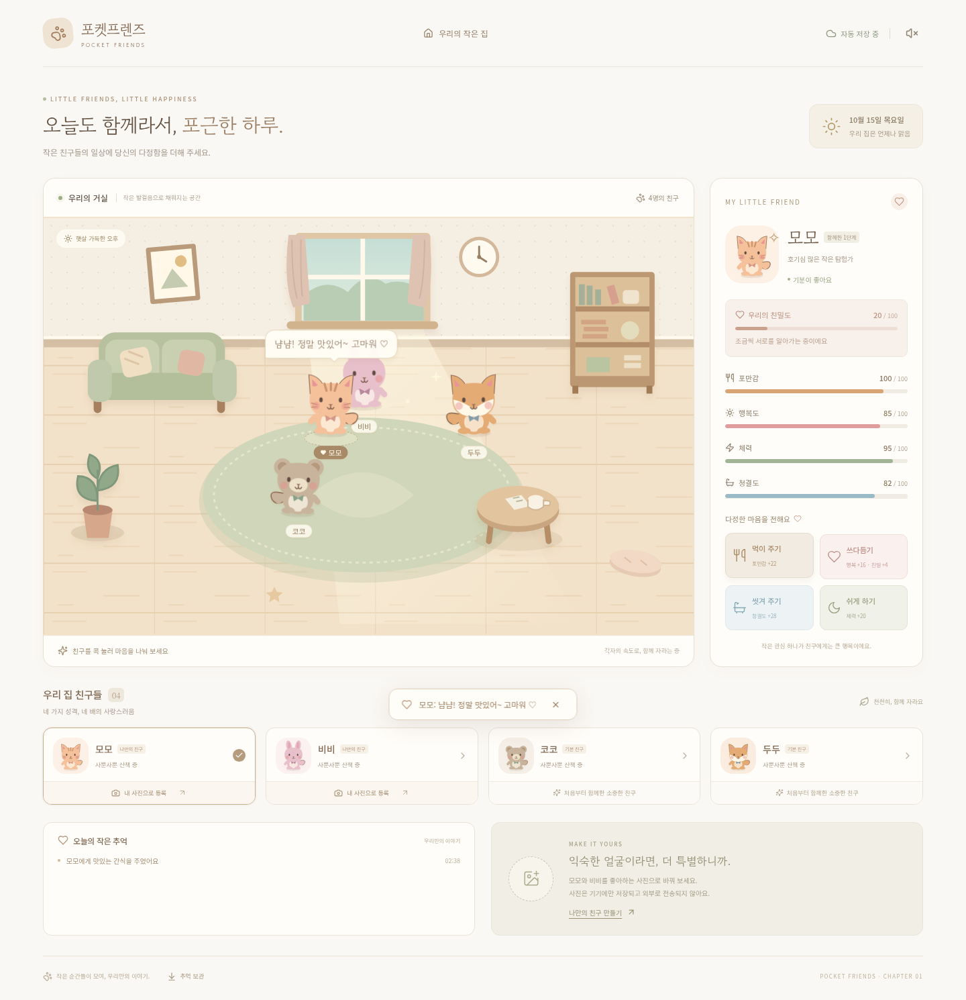

# 포켓프렌즈 · 우리의 작은 집

일반 친구 최대 8명과 특별 지급 남자아이·여자아이 2명, 작은 햄스터가 함께 생활하는 따뜻한 2D 웹게임입니다.
React 19 + TypeScript + Vite를 사용합니다. 개발 서버의 로컬 모드와 운영 배포의 Supabase 공유 월드 모드를 지원합니다.

[업데이트 PC 화면](docs/screenshots/life-expansion-desktop.png) · [업데이트 모바일 화면](docs/screenshots/life-expansion-mobile.png)

**최신 업데이트: [체력 회복 음식 3종·두 친구 공통 취향·한국 시간 시계·일일 TOP 5](docs/RECOVERY_DAILY_UPDATE.md). 단어는 690개(5,000개 목표 미완료), 자연 회복 변경은 기준 선택 대기입니다. 기존 저장을 유지하며 추가 SQL은 없습니다. [클릭별 배포 순서](docs/RECOVERY_DAILY_UPDATE.md#초보자용-적용-순서) · [검증 결과](docs/RECOVERY_DAILY_VERIFICATION.md)**

**이전 업데이트: [씻기 4회·사천성 연결/제거 효과·경쟁 섞기 1회·상태 이모션](docs/CARE_EFFECTS_UPDATE.md). 기존 데이터와 랭킹을 유지하며 새 SQL은 없습니다. [클릭별 상세 배포 안내](docs/CARE_EFFECTS_UPDATE.md#6-배포-방법-이-순서대로-눌러-주세요) · [검증 결과](docs/CARE_EFFECTS_VERIFICATION.md)**

**이전 업데이트: [사천성 탐험·경쟁·자동 섞기 배포 안내](docs/SICHUAN_UPDATE.md). 기존 데이터를 유지하며 새 SQL은 없습니다. 서버를 기능 브랜치로 먼저 배포하고 PR을 병합하세요. [검증 보고서](docs/SICHUAN_VERIFICATION.md)**

**이전 업데이트: [다중 구매·일괄 판매·오답 노트·방 면적 1.5배 배포 안내](docs/WIDE_UPDATE.md). 기존90개에 난이도별100개씩 추가하여 단어는390개입니다. 추가 SQL 한 개 적용 후 서버 → 화면 순서로 배포합니다. [검증 보고서](docs/WIDE_VERIFICATION.md)**



[모바일 화면 보기](docs/screenshots/mobile.png) · [특별 교감 화면](docs/screenshots/bonding-desktop.png) · [모바일 교감 화면](docs/screenshots/bonding-mobile.png)

## 남자아이·여자아이 특별 친구

고정 ID로 한 번만 무료 등록하며 일반 입양 한도·기존 코인·사진·육성 데이터를 유지합니다. 각자 28개 대사와 교감·자율 이동·탐험·개명을 지원합니다. 첨부 자료는 앉은 커플 그림 한 장이어서 독립 투명 PNG 2개를 이미지 편집으로 재구성했고, 없는 방향·동작 이미지는 CSS 효과로 대체했습니다. [구현 범위·이미지 한계·배포 순서](docs/HUMAN_FRIENDS.md) · [PC 화면](docs/screenshots/human-friends-desktop.png) · [모바일 화면](docs/screenshots/human-friends-mobile.png)

## 2단계: 성장과 수집

레벨 1~50, 천천히 변하는 다섯 성격, 코인·상점·인벤토리, 현실 시간 탐험, 전설 보물·도감, 한국 날짜 출석·미션·업적을 추가했습니다. 기존 네 친구의 이동·교감·사진 기능은 유지합니다.

[2단계 플레이 방법·밸런스·저장·배포 안내](docs/STAGE_TWO.md) · [PC 화면](docs/screenshots/stage2-desktop.png) · [상점 화면](docs/screenshots/stage2-shop.png) · [모바일 탐험 화면](docs/screenshots/stage2-explore-mobile.png)

## 바로 실행하기

Node.js 24와 npm을 사용합니다. 터미널에서 저장소 폴더를 열고 실행하세요.

```bash
npm ci
npm run dev
```

Vite가 표시하는 주소를 브라우저에서 여세요. PC와 모바일 터치 화면을 지원합니다.
클라우드에서는 기존 `/workspace/pocket-friends` 체크아웃을 사용합니다.

## 게임 방법

1. 방 안의 캐릭터를 **짧게 톡** 누르면 하트와 함께 기뻐합니다. **0.8초** 누르면 눈을 감고, **2초**를 채우면 특별 교감 대사와 여러 하트가 떠오릅니다. 사진 캐릭터의 얼굴은 바꾸지 않습니다.
2. 캐릭터를 누른 채 끌면 원하는 위치로 옮길 수 있습니다. 놓으면 통통 착지하고 약 1.5초 뒤 다시 걷습니다. 가구 안이나 방 밖에는 놓이지 않습니다. 상세 상태만 확인하려면 아래 친구 카드를 누르세요.
3. **먹이 주기**에서 보유한 음식을 고르고 **씻겨 주기**로 30분 목욕을 시작합니다(하루 두 번). **생활·입양**에서 이름 변경·감기약·입양·햄스터를 관리합니다. 쓰다듬기 보상은 아래의 6시간 쿨타임을 적용합니다.
4. 친구들은 가구를 피해 걷고, 가구 근처에 머물거나 잠깐 쉽니다. 친구에게 다가가 인사하면 행복도와 친밀도가 올라갑니다.
5. 고정 ID로 구분한 영이·찬미 역할의 특별 친구만 20~50초 간격으로 혼잣말합니다. 일반 친구는 평소 조용히 지내고, 터치·돌봄·상태 알림에서 반응합니다. 만남은 몸짓으로 표현합니다.
6. **모모·비비** 카드 아래 **내 사진으로 등록**을 눌러 각각 사진을 등록하세요. JPG·PNG·WebP, 최대 12MB를 지원합니다. 사진 전체에서 원하는 친구가 보이도록 확대·좌우·상하 위치를 맞춘 뒤 **이 모습으로 등록하기**를 누르세요. 같은 사진을 두 번 선택해 서로 다른 부분을 각각 등록할 수도 있습니다. 코코와 두두는 직접 그린 SVG 기본 캐릭터입니다. 사진 등록 전에는 네 친구 모두 기본 모습으로 등장합니다.
7. 위쪽 스피커 버튼은 돌봄 효과음을 켜고 끕니다. 기본은 꺼짐입니다.

## 교감 보상과 조작 규칙

- 일반 쓰다듬기: 행복도 **+2**, 친밀도 **+1**. 상태 패널의 쓰다듬기도 동일합니다.
- 특별 교감: 누른 채 **2초**를 채울 때 행복도 **+5**, 친밀도 **+3**을 한 번 지급합니다.
- 일반/특별/패널 보상은 친구별 **6시간(360분) 쿨타임**을 공유합니다. 쿨타임 중에도 애니메이션과 대사는 계속 반응하며, 행복도·친밀도·XP 등 반복 보상은 지급하지 않습니다. 상세 패널에서 남은 시간을 확인합니다. 새로고침으로 쿨타임이 초기화되지 않습니다.
- 0.8~2초 사이에 손을 떼면 반응은 보여주지만 보상은 지급하지 않습니다. 드래그로 전환하면 진행 중인 쓰다듬기를 취소하고 드래그 보상을 지급하지 않습니다. 2초 교감이 이미 성립한 뒤 이동하면 이미 받은 보상은 유지하고 추가 보상은 지급하지 않습니다.
- 머리 쪽은 몸통보다 하트와 움직임이 풍부합니다. 친밀도 0~30/31~70/71~100에 따라 대사가 달라지고, 가까운 친구는 특별 교감 효과도 커집니다. 네 친구의 말투도 서로 다릅니다.
- 마우스 8px, 터치 12px, 펜 10px 이상 움직이면 드래그입니다. 그보다 작은 손 떨림은 허용합니다. 잡고 있는 동안 자동 이동과 일반 대사가 중단됩니다.
- 터치 취소, 포커스 이탈, 화면 크기 변경, 포인터 캡처 해제, Esc에서 안전하게 놓습니다. 캐릭터 위에서만 스크롤/기본 길게 누르기 메뉴를 막고 나머지 페이지는 스크롤할 수 있습니다.
- 키보드로 캐릭터에 초점을 맞추고 Enter/Space를 누르면 일반 쓰다듬기를 할 수 있습니다.

보상·시간·드래그 거리·친구별 머리 영역은 [`src/balance.ts`](src/balance.ts)에서 조정할 수 있습니다. [교감 시스템 구조](docs/INTERACTIONS.md)도 참고하세요.

## 저장과 개인정보

- 상태·친밀도·사진·최근 추억을 **현재 브라우저의 IndexedDB와 기존 localStorage 키**에 5초마다, 돌봄/사진 등록 직후, 페이지 이탈 시 저장합니다.
- 다시 접속하면 상태를 복원하고, 자리를 비운 시간에 따라 포만감·행복도·체력·청결도를 줄입니다. 오프라인 감소는 최대 8시간까지만 적용됩니다.
- 사진은 브라우저에서 256px WebP로 줄여 저장합니다. 로컬 모드에서는 이미지와 육성 데이터를 외부 서버로 전송하지 않습니다. 클라우드 모드는 인증된 공유 월드에 사진과 육성 데이터를 저장합니다. 글꼴도 앱에 포함되어 Google Fonts 연결이 필요 없습니다.
- 로컬 모드는 브라우저/기기/사이트 주소가 바뀌면 저장 데이터가 공유되지 않습니다. 클라우드 모드는 같은 공유 월드에 입장한 기기끼리 공유합니다. 시크릿 모드 종료나 사이트 데이터 삭제 시 데이터가 지워질 수 있습니다.
- 저장 공간이 부족하면 경고합니다. 화면 아래 **추억 보관**을 누르면 현재 데이터를 JSON 파일로 내려받습니다. **추억 불러오기**에서 JSON을 검증한 뒤 복원할 수 있습니다. 복원 직전 게임도 별도로 백업합니다.

## 검증 명령

```bash
npm test                 # 이동·돌봄·교감 상태 전이·보상·쿨타임·기존 저장 호환성
npm run build            # TypeScript 검사 + 배포용 dist 생성
npx playwright install chromium  # 브라우저가 없을 때 최초 한 번
npm run test:e2e         # PC 및 모바일 Chromium 기능 테스트
npm run preview          # 빌드 결과 확인
```

운영 빌드는 클라우드 인증을 필수로 사용합니다. 설정 없이 만든 빌드의 preview에서는 게임 대신 설정 안내가 나오는 것이 정상입니다. 로컬 개발은 `npm run dev`를 사용하세요.

브라우저 테스트는 시스템 Chromium이 있으면 사용하고, 없으면 Playwright Chromium을 사용합니다.
CI에서는 `npx playwright install --with-deps chromium`으로 브라우저와 시스템 라이브러리를 준비합니다.
모바일 테스트는 Chromium의 iPhone 13 화면 크기·터치 에뮬레이션이며 실제 iOS Safari 검증은 별도입니다.

## GitHub Pages에 배포하기 — 처음 한 번

저장소 소유자 권한으로 다음 순서대로 눌러 주세요.

1. GitHub에서 **kwonyoung1/pocket-friends** 저장소를 엽니다.
2. 위쪽 **Settings** → 왼쪽 **Pages**를 누릅니다.
3. **Build and deployment** 아래 **Source**를 **GitHub Actions**로 선택합니다. 공유 월드의 URL·공개 키·서버 설정은 [최신 배포 안내](docs/CARE_UPDATE.md)를 따릅니다. 설정이 없으면 운영 화면은 입장을 차단합니다.
4. 게임 코드를 `main`에 반영합니다. PR이 아직 없으면 **Pull requests** → **New pull request** → base **main**, compare **feat/care-dialogue-cooldowns** → **Create pull request**를 누르세요. 만든 PR에서 초안이면 **Ready for review** → **Merge pull request** → **Confirm merge**를 누릅니다. PR 병합은 사이트 배포를 시작합니다.
5. 위쪽 **Actions** → **Test and deploy Pocket Friends**를 누르면 빌드·테스트·배포 진행 상태가 보입니다. 이미 main에 반영되어 있으면 **Run workflow** → Branch **main** → **Run workflow**로 수동 실행할 수도 있습니다.
6. 모든 단계가 초록색이면 **Settings** → **Pages** → **Visit site**를 누르세요.

`.github/workflows/deploy.yml`은 PR에서 빌드·단위 테스트·PC/모바일 브라우저 테스트를 실행하고, `main` 반영 시에만 Pages에 배포합니다. 테스트가 실패하면 배포하지 않습니다. 저장소 요금제/공개 범위에 따라 GitHub Pages 사용 가능 여부가 달라질 수 있습니다.

## 구성

- `src/game.ts`: 가구 회피 경로 탐색, 독립 이동/휴식, 인사, 대사, 육성, 저장 데이터 검증
- `src/interaction.ts`, `src/balance.ts`: 교감 상태 머신, 보상 제한, 친밀도/말투/부위별 반응 설정
- `src/InteractiveFriend.tsx`: 포인터 캡처, 입력 취소, 드래그·표정·하트 UI
- `src/navigation.ts`: 이동 경로 및 안전한 드래그 위치 검사
- `src/App.tsx`: 게임 화면, 캐릭터 선택/돌봄, 사진 편집, 자동 저장
- `src/Character.tsx`, `src/Room.tsx`: 자체 제작 SVG 캐릭터 및 방 일러스트
- `src/styles.css`: PC/모바일 반응형 UI, 보행 모션, 동작 줄이기 설정
- `src/game.test.ts`, `tests/game.spec.ts`: 게임 로직 및 실제 브라우저 테스트

## 구현 범위와 남은 기능

기존 육성·사진·교감과 클라우드 공유 월드를 유지하며 음식 소비·장시간 목욕·한국 시간 수면·개명·지역별 탐험·32종 수집 가구 배치·감기·새 식구 4명·희귀 햄스터·발견 도감·탐험 사건을 추가했습니다. [플레이/업데이트 안내](docs/LIFE_EXPANSION.md)를 확인하세요.
사진 속 여러 캐릭터 자동 분리/배경 제거, 성장에 따른 외형 진화, 실제 날씨 API는 포함하지 않습니다.
“오늘 날씨 한번 확인해야겠다~”는 캐릭터의 일상 대사이며 외부 날씨를 조회하지 않습니다.

## 클라우드 A단계

Supabase 인증·공유 월드 모드를 지원합니다. 새 프로젝트에서 처음 설정하는 경우에만 외부 설정과 배포가 필요합니다. 초보자용 클릭 순서는 [클라우드 설정 안내](docs/CLOUD_SETUP.md)를 확인하세요. `VITE_CLOUD_ENABLED=false`가 기본이며, 설정 전 사이트에는 비밀번호 보호가 적용되지 않습니다.
