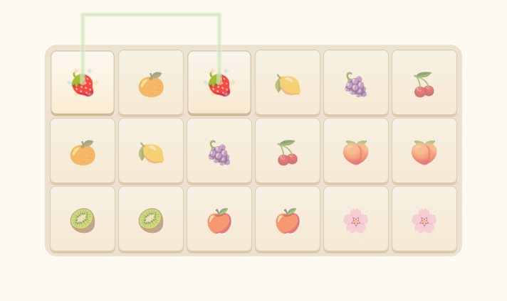

# 씻기·사천성·캐릭터 이모션 검증

검증일: 2026-10-17. 기준 main: `461c8f4`. 브랜치: `feat/care-tile-emotions`.

## 실제 실행 결과

- `npm test`: **163개 통과**, 16개 파일. 신규 13개를 포함합니다. 실제 PostgreSQL 호환 엔진(PGlite)의 서버 통합 검사 28개도 포함합니다.
- `npm run build`: TypeScript 및 Vite 빌드, 운영 번들에서 영단어 정답 은행 제외 검사 통과. 기존 500KB 이상 번들 경고는 남아 있습니다.
- Edge Function: frozen Deno lockfile 검사 통과.
- 신규 UI 검사 `tests/care-effects.spec.ts`: PC·모바일 **10개 통과**.
- 전체 `npm run test:e2e -- --workers=2`: **104개 중 102개 통과**. 기존 목욕 검사 두 건은 이름이 같은 메인 버튼과 생활 창 버튼을 동시에 찾는 테스트 선택자 문제였습니다. 생활 창 안의 정확한 버튼으로 범위를 제한한 뒤 `--grep 'owned food, favorites'`로 PC·모바일 **2개 모두 재검사 통과**했습니다. 이로써 전체 104개 항목의 성공을 확인했습니다. 검사 실패를 숨기기 위해 동작 검증이나 횟수·시간·저장 보존 검증을 삭제하지 않았습니다.
- `npm run test:cloud -- --workers=2`: **34개 모두 통과**(3.1분). 기존 30개와 새 목욕 횟수 공유·사진/원본 보존·경쟁 섞기 복원·실제 연결 이펙트 4개를 포함합니다.
- [실제 브라우저의 제거 효과 중간 프레임](screenshots/care-tile-match.png): 테스트용 보드를 일반 시계로 실행하고 두 번째 패 선택 약 270ms 뒤 캡처했습니다. 상단 외곽 경유 연결과 두 패의 반짝임을 확인할 수 있습니다.

## 요청 항목과 검증 근거

| 요청 | 검사 내용 |
|---|---|
| 씻기 하루 4회 | 4번 실제 시작·완료 후 5번째 차단, 이전 2회 기록에서 2번만 추가 사용 |
| 친구별 횟수·30분 유지 | 서로 다른 친구의 기록 독립, 시작 시각+1,800,000ms 종료 시각, 분·초 표시 |
| KST 자정 | 자정에 횟수 초기화, 자정을 넘기는 목욕은 원래 시각에 완료 |
| 동시·중복 요청 | 실제 SQL 트랜잭션에서 두 기기가 4번째 목욕 동시 요청, 같은 작업 재시도, 완료 보상 한 번 |
| 새로고침·서버 시간 | 4회 사용 기록 복원, 기기에서 제시한 미래 시각 무시, 클라우드 UI의 기기 간 횟수 공유 |
| 진짜 사천성 연결선 | 기존 path 함수와 SVG의 data-grid-path 일치, 외곽 좌표와 그림판 내부 실제 위치 검사 |
| 제거 효과 | 두 패 강조·12개 빛 알갱이·0.45초 후 해제, 일반 시계 브라우저 프레임 직접 확인 |
| 중복 제거·시간 | 효과 중 같은 패 재입력 후 보드/턴 한 번만 갱신, 제한시간 계속 진행, 기존 경쟁 시간·랭킹 검사 유지 |
| 콤보 | 3초 경계·초과 초기화 단위 검사, 실제 10쌍 연속 입력으로 Nice/Great/Perfect 확인, 잘못 선택하면 초기화, 추가 코인 없음 |
| 경쟁 섞기 1회 | 한 번 사용 후 비활성화, 서버에서 2번째 거부, 중복 요청으로 횟수 추가 차감 없음, 새 판에서 1회 |
| 기존 경쟁 세션 | 이전 남은 3/2/1/0회 각각 1/0/0/0회로 변환, 보드·시작 시각·최고 기록 그대로 유지 |
| 탐험·자동 섞기 | 탐험 수동 3회 유지, 탐험/경쟁 교착 자동 섞기·개수 보존·보장 fallback·수동 불차감 검사 유지 |
| 상태 이모션 | 질병→배고픔→청결→피곤함 순서, 한 종류씩, 주기 120,000~240,000ms, 1,800ms 만료 |
| 상태 회복·우선순위 | 회복된 종류 즉시 숨김, 목욕·교감 중 숨김, 저장 복원 시 재표시 도배 없음 |
| 사진·움직임 보존 | 위치·상태 수치 비변경 검사, 사진·코인 보존, 기존 자율 이동·드래그·교감·사진 등록 테스트 유지 |
| 겹침·모바일 | 말풍선과 이모션의 실제 사각형 비교, 가로 넘침 없음, 실제 터치 입력·보드 스크롤 방지 검사 유지 |
| 동작 줄이기 | prefers-reduced-motion에서 선 애니메이션 없음, 별 입자 숨김, 연결선과 단순 강조는 유지 |

## 개발 중 수정한 내용

- 이모션의 난수를 이동 로직과 분리했습니다. 새 표현 때문에 기존 이동 목적지의 난수 순서가 바뀌지 않습니다.
- 목욕 남은 시간이 화면에 고정되지 않도록 생활 창 자체에 1초 갱신을 추가했습니다.
- 복구 검사는 localStorage만 직접 바꾼 뒤 새로고침하는 방식 대신 실제 씻기 버튼과 목욕 완료를 사용합니다. 기존 자동 저장은 페이지 종료 시 현재 게임 상태를 저장하므로 localStorage만 고치는 테스트는 현실적인 회복 행동을 재현하지 못했습니다.
- 화면의 백분의 1초 출력과 80ms 렌더링 주기를 비교해 잘못 실패하지 않도록, 제거 효과 검사에서는 타이머 진행과 원래 절대 종료 시각을 확인합니다. 서버 시각의 정확한 종료·보상 검증은 유지했습니다.

## 확인하지 않은 범위

운영 Supabase에 테스트 데이터를 쓰거나 월드를 초기화하지 않았습니다. 클라우드 UI 검사는 실제 React/인증 HTTP 흐름/게임 핸들러에 테스트 저장소를 연결하며, RLS·행 잠금·CAS·작업 영수증은 별도 PGlite SQL 검사로 확인합니다.

PC 및 iPhone 13 크기의 Chromium 터치 에뮬레이션을 사용했습니다. 실제 휴대폰 하드웨어·iOS Safari의 성능은 직접 확인하지 않았습니다. 운영 배포도 사용자가 서버 배포와 PR 병합을 완료해야 반영됩니다. 기존 익명 인증 계정 구조를 유지하므로 별도로 로그인한 PC와 휴대폰의 경쟁 선수 ID를 같은 인물로 합치는 기능은 추가하지 않았습니다.

새 SQL·새 Supabase 프로젝트·새 Secrets는 필요하지 않습니다. 상세한 클릭 순서는 [배포 안내](CARE_EFFECTS_UPDATE.md#6-배포-방법-이-순서대로-눌러-주세요)에 있습니다.
