# 시즌 2 실제 구현 이미지

전신 원화와 별도 제작 전투 도트 자산입니다. 영이·찬미 원본은 변경하지 않았습니다. 도트마다 두 대기·두 걷기·기본 공격·Lv.20·Lv.35·피격·승리·쓰러짐의 10포즈가 있으며 기존 20슬롯에서 재사용합니다.

| 캐릭터 | 전신 일러스트 | 전투 도트 시트 |
| --- | --- | --- |
| 아리아 | 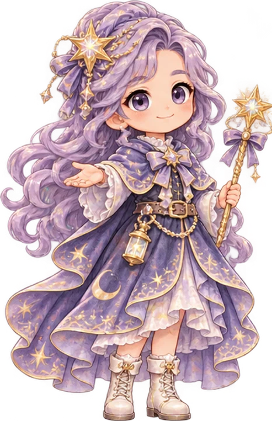 | 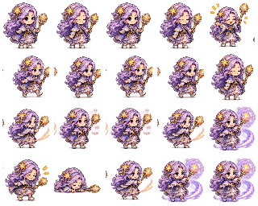 |
| 레온 | 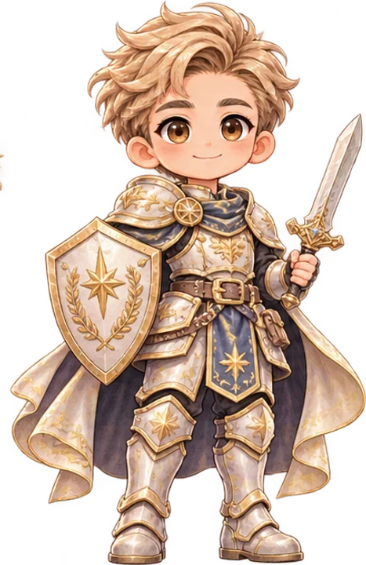 | 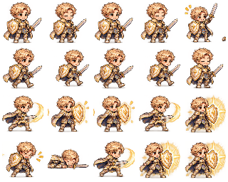 |
| 엘리 | 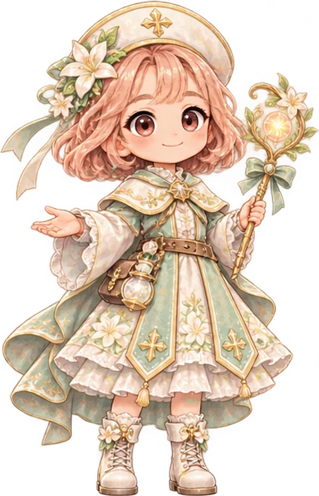 | 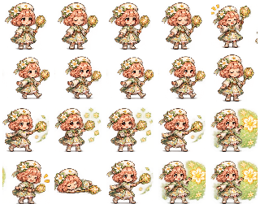 |
| 카이 | 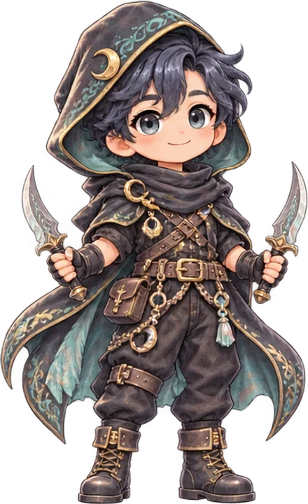 | 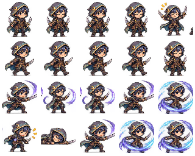 |
| 세린 | 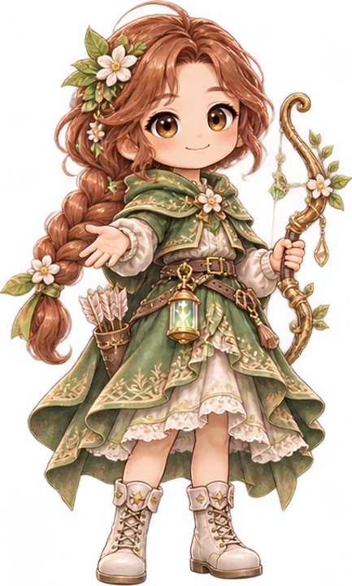 | 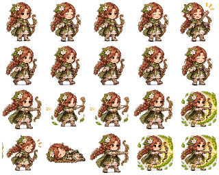 |
| 시온 | 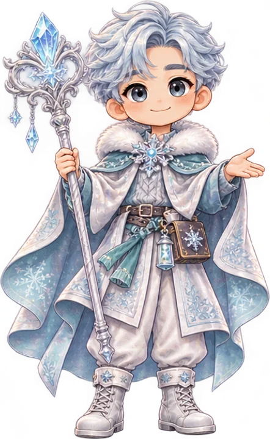 | 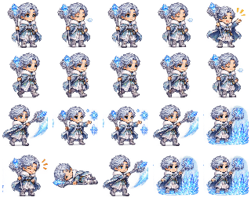 |
| 로제 | 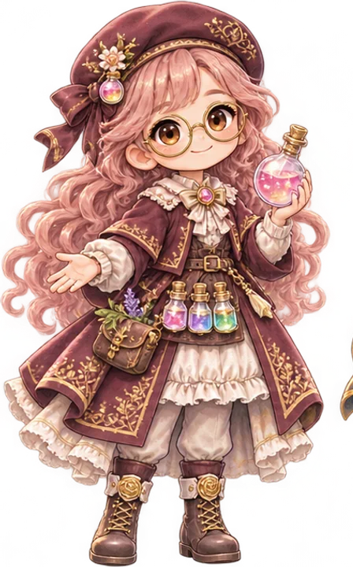 | 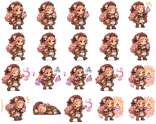 |
| 루시안 | 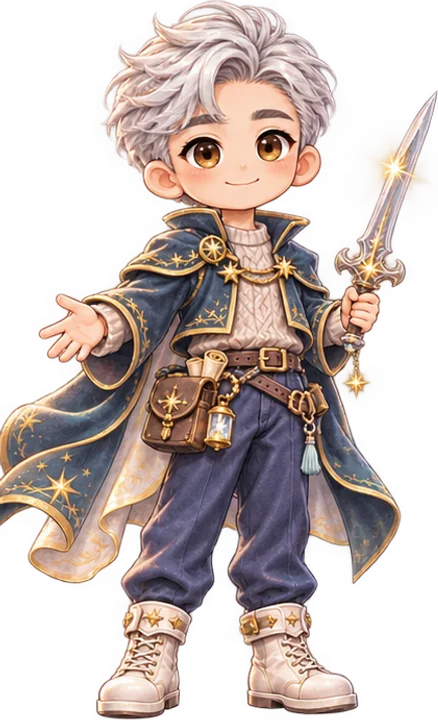 | 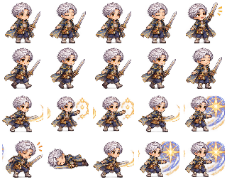 |
